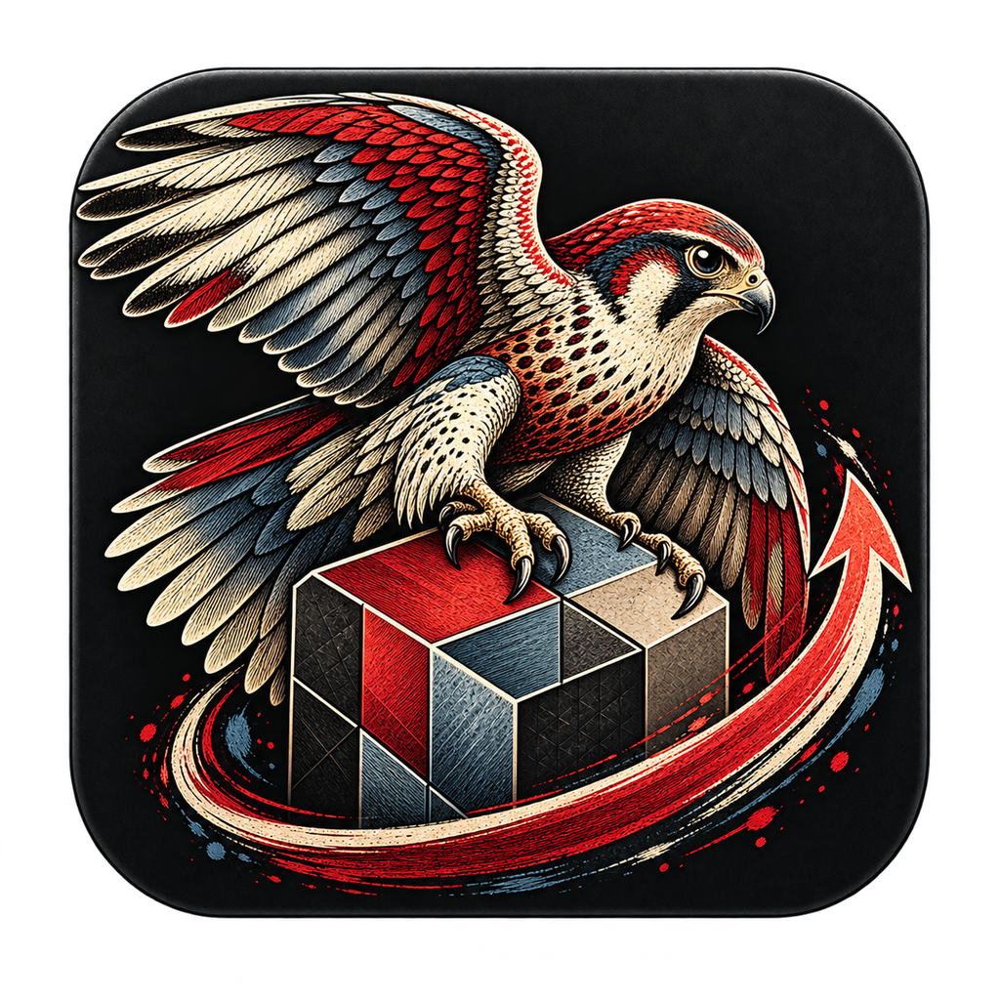

<p align="center">
  
</p>

<h1 align="center">ReLauncher</h1>

<p align="center">
  <b>One home for every Re program.</b><br>
  Install, update and launch ReEtched and the rest of the Re family, all in one place.
</p>

<p align="center">
  <a href="https://github.com/Redactional/ReLauncher/releases/latest"></a>
  <a href="https://github.com/Redactional/ReLauncher/actions/workflows/ci.yml"></a>
  
  <a href="#license"></a>
</p>

<p align="center">
  <a href="https://redactional.github.io/ReLauncher/"><b>Website</b></a> ·
  <a href="#download">Download</a> ·
  <a href="#features">Features</a> ·
  <a href="docs/adding-programs.md">Add a program</a> ·
  <a href="https://github.com/Redactional/ReLauncher/issues/new/choose">Report a bug</a>
</p>

---

## Download

Get it from the **[website](https://redactional.github.io/ReLauncher/)**, which picks the right file for your system, or from the [latest release](https://github.com/Redactional/ReLauncher/releases/latest):

| System | Download |
|---|---|
| Windows 10 / 11 (64-bit) | Installer (`.exe`) |
| macOS (Apple Silicon) | Disk image (`.dmg`) |
| Linux (x86-64) | `.deb` package or `.AppImage` |

## Features

- **Every Re program in one library.** See what's installed, what's new, and launch it with one click.
- **Always up to date.** ReLauncher checks each program's latest release and tells you when an update is ready, along with the release notes. Updates replace the old version in one step.
- **Install where you want.** Choose the install folder in Settings. The defaults need no administrator rights:
  - Windows: `%LOCALAPPDATA%\Programs\Re`
  - macOS: `~/Applications`
  - Linux: `~/.local/share/re-programs`
- **Found by your system search.** Installed programs get a Start Menu entry on Windows and an application entry with their icon on Linux. On macOS, Spotlight and Launchpad find them.
- **Sets up what programs need.** Required components, like the Microsoft Visual C++ Runtime, are checked and installed along with the program. Optional extras are listed with a link to get them.
- **Clean removal.** Uninstalling deletes only the program's own folder, never your projects or anything ReLauncher didn't create.
- **New programs appear automatically.** The program list is published from this repository, so new Re programs show up without a ReLauncher update.

## Using ReLauncher

1. Pick a program in the library.
2. Click **Install**. Its requirements are set up first; Windows may ask for permission for some of them.
3. Click **Launch**, or find the program in your system search.

When an update is out, the program shows **Update available**. Click **Update to …** to get it. The refresh button checks again at any time.

## Building from source

You need [Rust](https://rustup.rs) 1.96 or newer.

```bash
cargo run --release
```

See [CONTRIBUTING.md](CONTRIBUTING.md) for tests, the program list and how releases are made.

## Contributing

- **Found a bug or have an idea?** [Open an issue](https://github.com/Redactional/ReLauncher/issues/new/choose).
- **Problem with a program itself** (not installing or launching it)? Report it in that program's repository, for example [ReEtched](https://github.com/Redactional/ReEtched/issues/new/choose).
- **Maintain a Re program?** See [Adding a program](docs/adding-programs.md).

## License

ReLauncher is dual-licensed under [MIT](LICENSE-MIT) or [Apache 2.0](LICENSE-APACHE), at your option.
